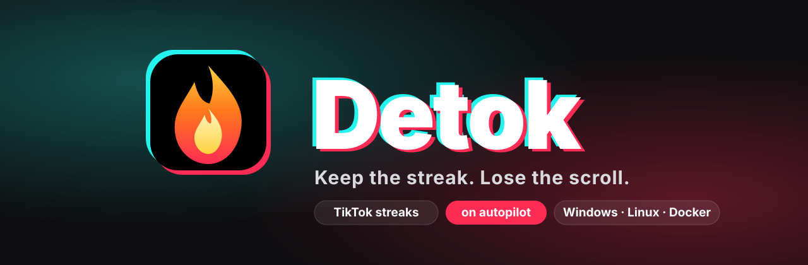
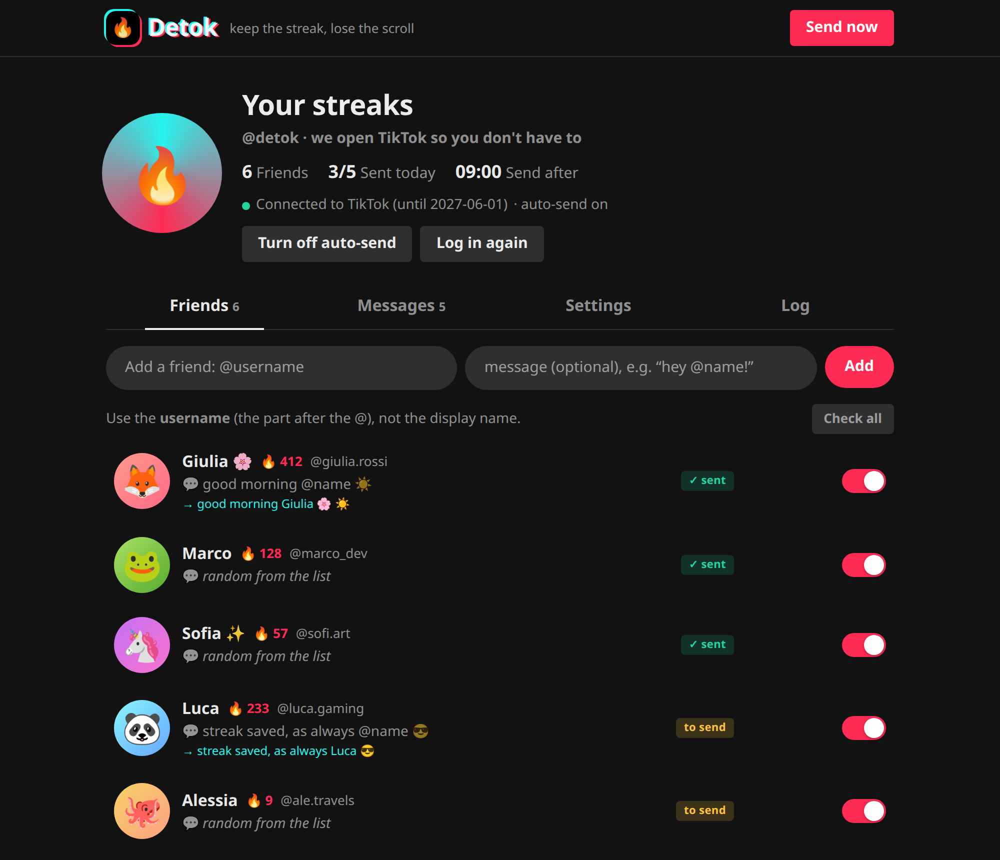
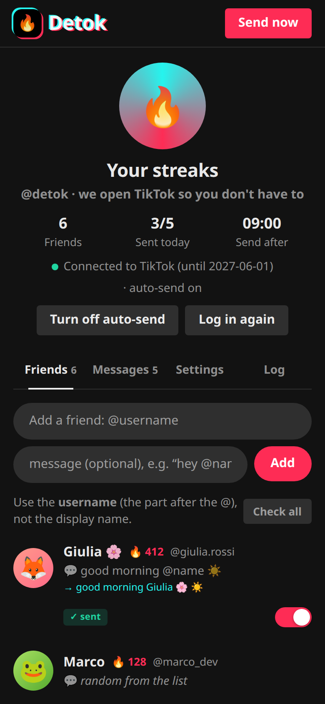

<div align="center">



### Your TikTok streaks, on autopilot. Your thumb, finally free.

**Detox** + **TikTok** = **Detok** — the TikTok detox that doesn't cost you a single 🔥.

[](https://github.com/zGenny/detok/releases)
[](https://github.com/zGenny/detok/stargazers)

[](https://github.com/zGenny/detok/releases/latest)
[](https://github.com/zGenny/detok/actions/workflows/ci.yml)
[](https://github.com/zGenny/detok/pkgs/container/detok)
[](#install)
[](LICENSE)

[**Download**](https://github.com/zGenny/detok/releases/latest) · [How it works](#how-it-works) · [Docker](#server--homelab-docker) · [FAQ](#faq)

</div>

---

You know the blackmail: if you don't message that friend on TikTok today, the 🔥 goes out and 247 days of streak
go straight into the bin. So you open the app *"just to send one message"*… and forty minutes later you're still
watching cats playing the piano.

**Detok breaks the blackmail.** It sends the message for you, every day, to every friend you pick.
Uninstall TikTok if you want: your streaks stay lit, your thumb gets a rest.

<div align="center">
  
  &nbsp;
  
  <br><sub>Demo data — no real friends were harmed in the making of these screenshots.</sub>
</div>

> [!WARNING]
> Detok sends automated messages from your account and TikTok may not like that.
> Use it at your own risk — read the [disclaimer](#disclaimer) first.

## Features

- 🔥 **Never lose a streak again** — one message a day to every friend you pick, after the time you choose.
- 💬 **Not a robot (well…)** — a custom message per friend, or a random one from your list.
  `good morning @name!` becomes `good morning Giulia!`.
- 📈 **Streak counter** — see how many days in a row Detok has kept each streak alive.
- 🔁 **Self-healing** — a failed send is retried every hour, with a screenshot and one (just one) notification.
- 📱 **Feels like home** — a TikTok-flavoured web UI, dark mode included, works on your phone too.
- 🖥️ **Runs anywhere** — Windows, Linux, or 24/7 on your homelab / Raspberry Pi with Docker.
- 🔒 **Yours only** — everything stays on your machine. No accounts, no cloud, no tracking.

## Quick start

1. [Download](https://github.com/zGenny/detok/releases/latest) Detok and open it.
2. **Log in to TikTok** once in the window that pops up.
3. **Add your friends**, pick the messages, **turn on auto-send**. Done. Go touch grass. 🌱

## Install

Grab the latest build from [Releases](https://github.com/zGenny/detok/releases/latest).

### Windows
1. Download `detok-windows-x86_64.exe` and double-click it.
   SmartScreen may complain because the executable isn't signed: *More info → Run anyway*.
2. The UI opens in your browser. On first use Detok downloads Chromium (~150 MB, only once).
3. Automatic sending uses Task Scheduler: it works with the UI closed and without flashing windows.

### Linux (desktop)
```bash
chmod +x detok-linux-x86_64
./detok-linux-x86_64          # opens the UI at http://127.0.0.1:8765
```
Automatic sending uses a systemd user timer, so it works with the UI closed.

Or with Python (≥ 3.11):
```bash
pipx install git+https://github.com/zGenny/detok
detok
```

### Server / homelab (Docker)
```yaml
# docker-compose.yml
services:
  detok:
    image: ghcr.io/zgenny/detok:latest
    restart: unless-stopped
    ports: ["8765:8765"]
    environment:
      DETOK_PASSWORD: "change-me"   # required when not listening on localhost
      TZ: Europe/Rome               # "send after" follows this time zone
    volumes: ["./data:/data"]
    shm_size: "1gb"
```
```bash
docker compose up -d     # then open http://SERVER-IP:8765 (any username, the password above)
```
Images are built for `amd64` and `arm64` (Raspberry Pi 4/5 included).

A server has no screen to log in to TikTok with, so:
1. on your PC, log in with Detok, then run `detok session export session.json`;
2. in the server UI press **Import session…** and pick that file;
3. delete `session.json`: whoever has it is logged into your account.

Without Docker: `DETOK_PASSWORD=... detok web --host 0.0.0.0 --no-browser` (the scheduler runs inside the process,
so wrap it in a systemd service or similar). To reach it from outside your home, use a VPN (Tailscale/WireGuard)
or a reverse proxy with HTTPS: over plain HTTP the password travels in clear text.

## Usage
1. **Log in to TikTok**: Chromium opens, log in once, then close the window.
2. **Add friends** by username (the part after the @, not the display name).
3. **Turn on** automatic sending.

Command line:
```
detok                      web UI (also: detok web --host --port --no-browser)
detok status               today's status
detok send [--force]       send now (--force ignores the time)
detok login                log in to TikTok
detok check [users…]       check accounts (name, avatar, whether you can message them)
detok timer on|off|status  automatic sending
detok session export|import FILE
detok setup                download Chromium
```

## How it works
- It opens `tiktok.com/@username`, then the chat, and types **only** if the chat header shows exactly that @:
  no messages to the wrong friend.
- It wakes up every hour but only sends **after your chosen time** and only to friends who **haven't received
  today's message yet**, so a failed attempt is simply retried an hour later.
- Data lives in a private folder: Linux `~/.local/share/detok`, Windows `%LOCALAPPDATA%\Detok`,
  Docker `/data` (or whatever `DETOK_HOME` says). The `profile/` subfolder holds your TikTok session: don't share it.
- By default the UI only listens on 127.0.0.1 and rejects requests coming from other websites.

| Variable | Purpose |
|---|---|
| `DETOK_HOME` | data folder |
| `DETOK_HOST`, `DETOK_PORT` | where the UI listens (default 127.0.0.1:8765) |
| `DETOK_PASSWORD` | UI password, required when not listening on localhost |
| `DETOK_SCHEDULER` | `systemd`, `windows` or `builtin` (picked automatically) |

## Limits (honesty first)
- It drives TikTok's web interface: if TikTok changes it, the selectors in `detok/sender.py` need updating.
- If headless sending gets blocked, turn off **Invisible browser** in the settings
  (desktop only: a window will pop up for a few seconds a day).

## FAQ

**Will my friends notice?**
Only if your messages are suspiciously consistent. Use a few random ones and `@name` and you'll pass the Turing test.

**Do I need to keep my PC on?**
Detok sends once a day, after the time you choose. If your PC is off it catches up as soon as it's back on —
or run it on a homelab / Raspberry Pi with Docker and forget about it.

**Can TikTok ban me for this?**
Possibly. It's one message a day per friend, but it's still automation. Read the [disclaimer](#disclaimer).

**Does Detok read my messages or send my data anywhere?**
No. It only opens the chats it needs to write in, and everything (settings, session, log) stays in a folder on your machine.

**My streak still died!**
Check the **Log** tab: there's an error and a screenshot of what Detok saw. If TikTok changed its website,
[open an issue](https://github.com/zGenny/detok/issues) and we'll fix it together.

## Disclaimer
**Use Detok at your own risk.**

- Detok sends **automated messages** from your account. TikTok's terms of service don't allow automated access,
  and nobody knows how TikTok feels about it: it might ignore it, it might show a captcha, and in the worst case
  it might **limit, suspend or ban your account**. One message a day per friend is very little, but the risk is not zero.
- The authors take **no responsibility** for anything that happens to your account, your streaks, your friendships,
  or for messages that are sent, sent twice, sent late or not sent at all.
- Your friends are receiving messages written by a bot. Maybe tell them — or don't, and see how long it takes them. 😉
- You are responsible for how you use it and for following TikTok's rules and the laws where you live.
- Detok is an independent hobby project. It is **not affiliated with, endorsed by or connected to TikTok or ByteDance**.
  "TikTok" is a trademark of its respective owner and is used here only to describe what the software works with.

The software is provided "as is", without warranty of any kind (see the [license](LICENSE)).

## Support the detox

If Detok saved one of your streaks (or one hour of your life), **leave a ⭐** — it's the only streak I'm chasing.
Share it with that friend who's always on TikTok. They need it more than you. 😏

<a href="https://star-history.com/#zGenny/detok&Date">
  
</a>

## License
[MIT](LICENSE)
